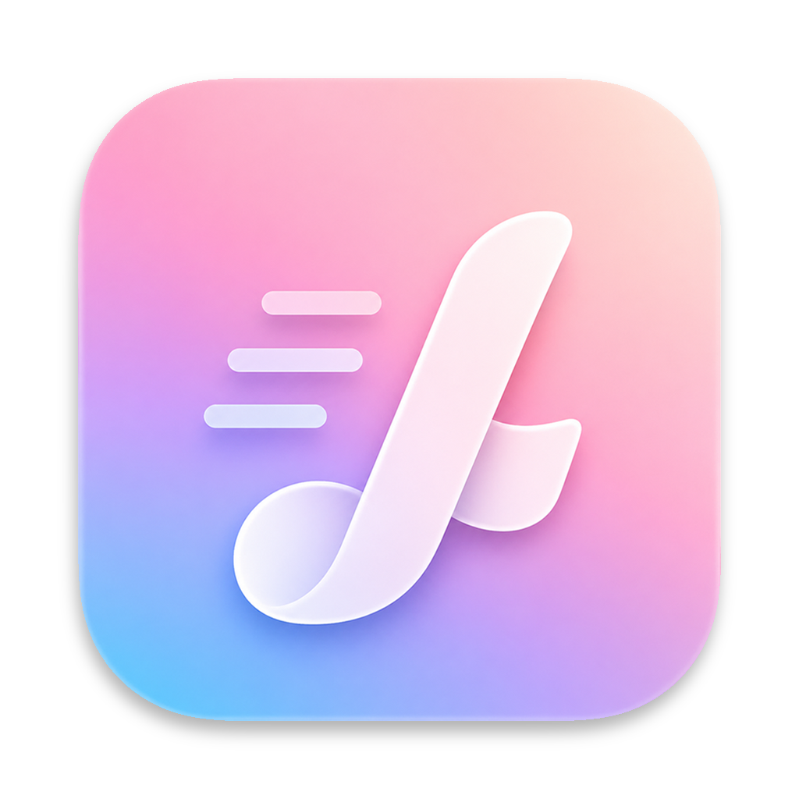
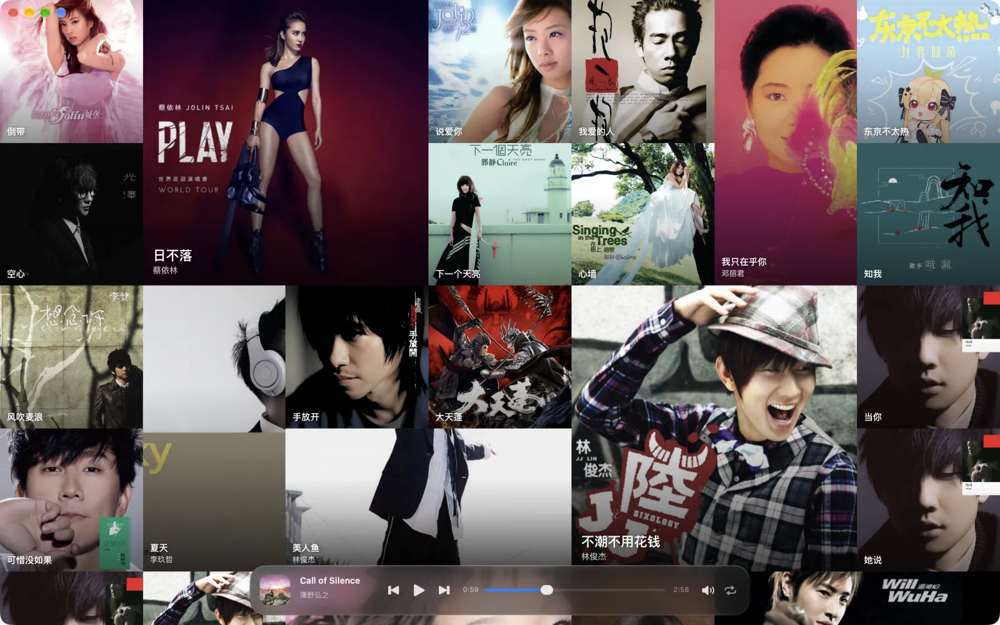
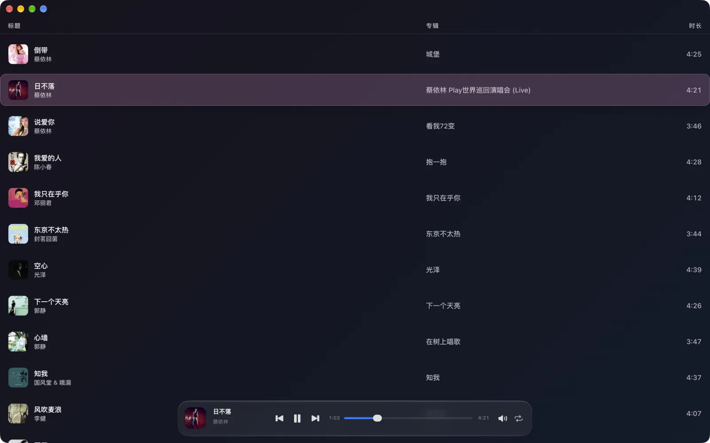
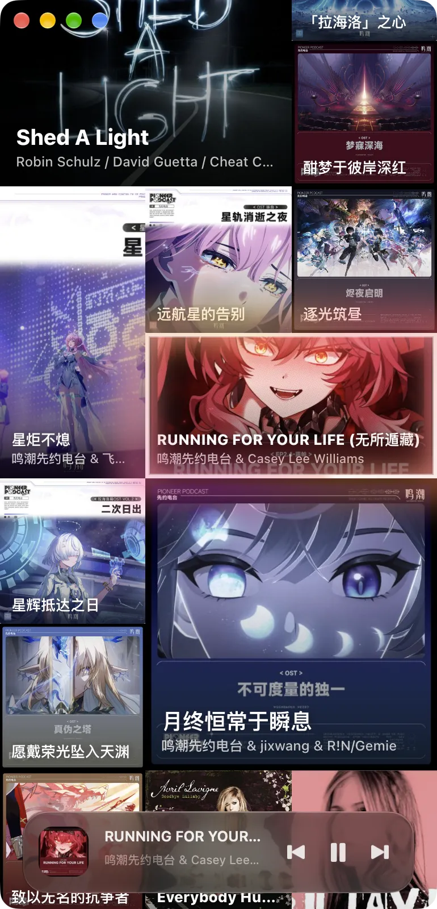
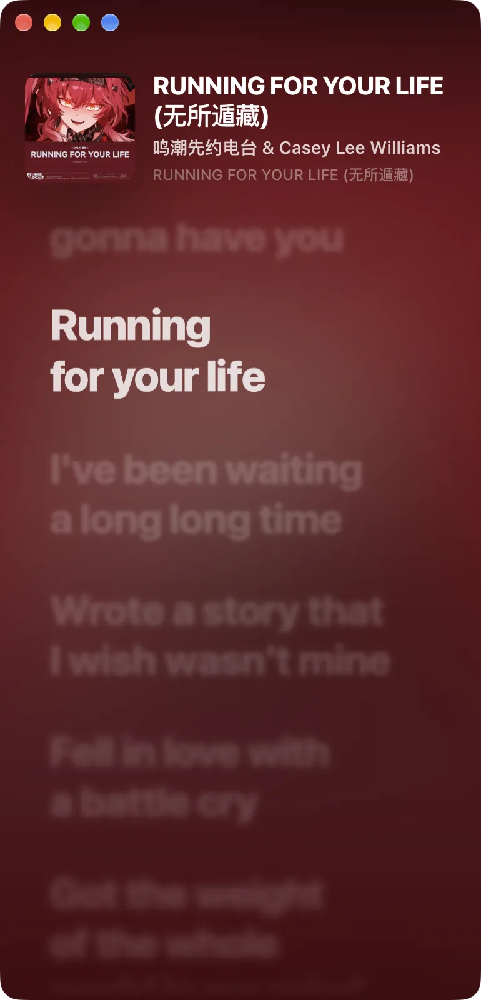
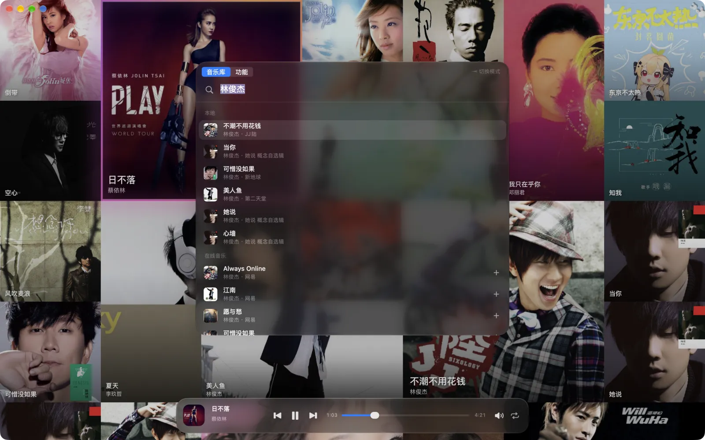
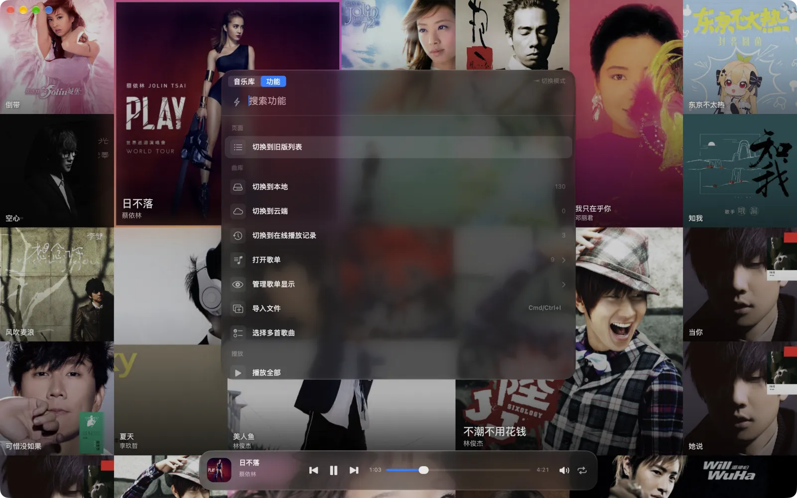
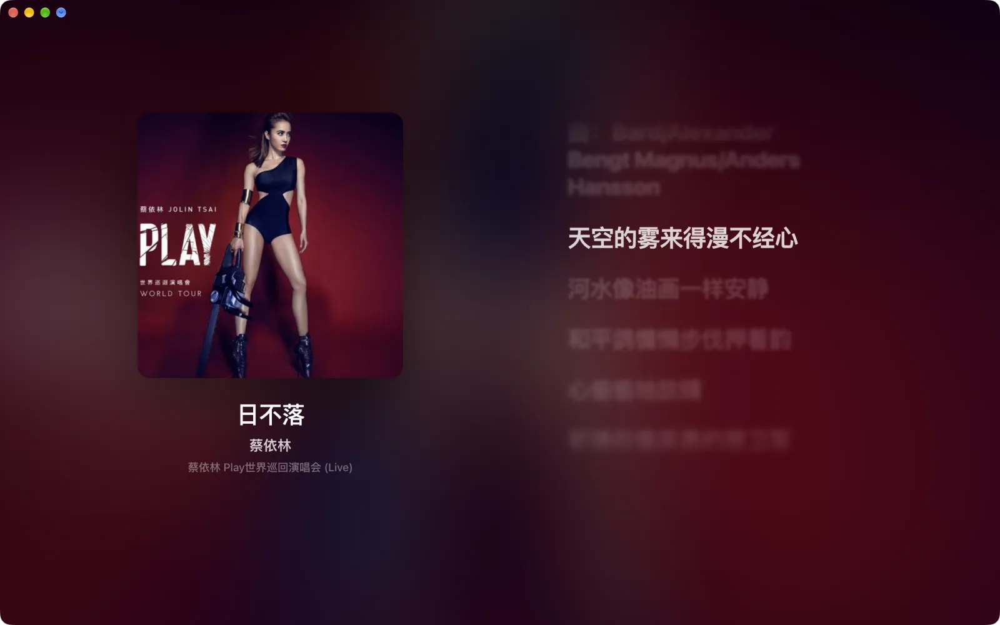
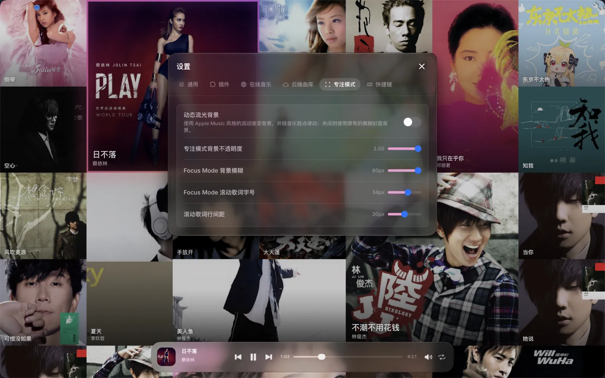

<div align="center">



# LyricsAdapter

**A desktop player built around local music and synchronized lyrics.**

Listen to your own collection, connect a WebDAV library, or add QQ Music and NetEase Cloud Music through plugins.

[Download](https://github.com/xwsjjctz/LyricsAdapter/releases) · [简体中文](README.md)

</div>



## Get started

Download the installer for your device from [Releases](https://github.com/xwsjjctz/LyricsAdapter/releases). The current release configuration provides a `.dmg` for Apple Silicon Macs and an `.exe` installer for Windows x64.

> **First install on Windows**: The installer is not code-signed yet, so Microsoft Defender SmartScreen may show **Windows protected your PC** with an unknown publisher. After confirming the installer came from this repository's Releases, select **More info**, then **Run anyway** to continue.
>
> **First launch on macOS**: The app is not notarized by Apple yet, so macOS may say it cannot verify the developer. Drag the app into **Applications** and try to open it once, then go to **System Settings → Privacy & Security**, select **Open Anyway** near the bottom, and confirm. If macOS says the app **is damaged and can't be opened**, run `xattr -dr com.apple.quarantine /Applications/LyricsAdapter.app` in Terminal and open it again.

1. Open the app and press `⌘ / Ctrl` + `I` to select **MP3 or FLAC** files, or drag audio files into the window. While the library is empty, you can also use **Import Files** in the middle of the window.
2. Click a cover to play it, and use the floating player at the bottom to control playback.
3. Use the Focus Mode button, or press `⌘ / Ctrl` + `Enter`, to view synchronized lyrics. On macOS the button is the blue dot next to the window controls at the top left; on Windows it sits on the right of the title bar.

Local playback requires no login. Importing reads the title, artist, album, artwork, and embedded lyrics from your files.

## Library and playback

### Poster wall

The library opens as a poster wall. Covers are laid out automatically for the window width in a mix of sizes, and narrow windows switch to a more compact layout. The playing cover glows with the music, and the wall scrolls to the current song when the track changes.

If you prefer a traditional list, choose **Switch to classic list view** in the command palette's **Features** mode; choose **Switch to poster wall view** to go back.



### Portrait

Resize the window to a tall shape to get the portrait layout. On macOS you can also choose **Window → Portrait** in the menu bar to switch to a narrow 385 × 800 window, and **Landscape** to switch back. In portrait, the poster wall uses its compact layout, and Focus Mode moves the artwork and song details to the top with lyrics filling the rest; the playback controls appear only while you interact.

<table>
  <tr>
    <td></td>
    <td></td>
  </tr>
</table>

### Playback controls

The floating player provides play/pause, previous/next track, seeking, volume, and mute controls. Sequential playback, shuffle, and repeat-one modes are available.

The app remembers the current library, track, playback position, volume, and related state, then restores them paused when reopened. You can keep listening while you browse another library or open a playlist.

### Command palette

Press `⌘ / Ctrl` + `K` to open the command palette, and press `Tab` to switch between its **Library** and **Features** modes.

- **Library** searches songs, artists, albums, and playlists across your local tracks and loaded cloud tracks, with support for Chinese pinyin and pinyin initials. With a music source plugin enabled, online songs appear too: click one to play it, click `+` to add it to your online history, or right-click to download it at a chosen quality.
- **Features** switches libraries, opens or manages playlists, imports files, starts multi-select, refreshes the cloud library, plays all or shuffles, locates the current song, changes the appearance and language, and opens each settings page.





### Switch libraries and playlists

**Local**, **Cloud**, **Online History**, and the playlists of signed-in platforms all work as libraries you can switch between. Pick one in the command palette, or use the playlist switcher: hold `⌘ / Ctrl` and press the key left of `1` (`` ` ``) repeatedly to cycle, then release `⌘ / Ctrl` to confirm. Add `Shift` to go backwards, or press `Esc` to cancel.

### Organize your local library

Right-click a cover (or press the keyboard's menu key) to:

- **Edit song information**: change the title, artist, album, or lyrics, or import new artwork. This is available for local tracks only, and saving writes the changes back to the audio file.
- **Select multiple songs**: start multi-select, with select-all, remove-selected, and done buttons at the bottom.
- **Remove from library**: take the song out of the library while keeping the original audio file.

In **Local** and **Online History**, drag covers to reorder them.

## Lyrics and Focus Mode

Focus Mode shows album artwork, an artwork-based background, and scrolling lyrics, with the main playback controls still available. Click a timed lyric line to jump to that part of the song.



- **Line-synced lyrics**: Embedded LRC lyrics scroll with playback.
- **Word-synced lyrics**: Songs with QRC/YRC or similar word timing highlight each word.
- **Display options**: In **Settings → Focus Mode**, turn on the Apple Music–style **Flowing Background**, or adjust background opacity, background blur, lyric font size, and line spacing. Windows also offers a **New FocusMode Font** switch.

A message appears when no lyrics are available. You can add lyrics with **Edit song information** on a local track; synchronized scrolling requires timestamps.



### System lyrics and media controls

| Platform | System lyrics |
| --- | --- |
| macOS | Shows the current lyric in the menu bar, with previous, play/pause, and next controls. |
| Windows | Shows lyrics in the taskbar, with word-by-word highlighting and hover playback controls. |

Playback information is also shared with system media controls so you can view the current song and control playback.

## WebDAV library

Press `⌘ / Ctrl` + `,` to open Settings. Under **Cloud Library**, enter the server address, account, and app password, test the connection, and save. Then choose **Switch to Cloud** in the command palette.

- Load music from the server, browse it as a poster wall or list, and stream it.
- Choose **Refresh cloud library** in the command palette's **Features** mode to update it.
- Search loaded cloud songs from the command palette.

Cloud playback requires a working network connection. Uploading local files and online songs to WebDAV is currently disabled; reading, playback, refresh, and metadata caching for existing cloud libraries remain unchanged.

## Online music and playlists

### Install a music source plugin

The QQ Music and NetEase Cloud Music integrations are maintained separately in [LyricsAdapter-Music-Plugins](https://github.com/xwsjjctz/LyricsAdapter-Music-Plugins). The main app starts without any plugins:

1. Open **Settings → Plugins** and download the QQ Music or NetEase Cloud Music plugin under **Official plugins**, or use **Install local plugin** to import a `.laplugin` file.
2. Once a plugin is enabled, its songs appear in command palette searches; sign in from the plugin card's **Settings**.

A first install takes effect immediately; updating an installed plugin requires restarting the app. Each plugin runs in its own process, and the app asks you to confirm the source before installing or updating a third-party plugin. Disabling a plugin keeps its songs, playlists, and sign-in data.

Plugins are stored in `~/.la/plugin/<plugin ID>/`; the Plugins page shows the actual path and can open the folder. Third-party developers can read the [plugin API documentation](docs/plugins/README.md) to register music sources or lyric translation through the general API; any music source plugin can join the online music interface through its manifest. An enabled translation plugin adds a Translate button to Focus Mode for side-by-side translations. See [music source plugins](docs/music-source-plugins.md) for the contract and build notes.

### Sign in

In **Settings → Plugins**, open the music source plugin's **Settings**, then scan the QR code with that platform's mobile app and confirm, or paste a cookie and choose **Verify & Save**. The plugin card shows whether you are signed in.

QQ Music requires valid sign-in credentials for online search. NetEase Cloud Music supports anonymous search and previews. Personal playlists require signing in to the platform. Playback, downloads, and available audio quality depend on the resources and account permissions returned by each platform.

### Search, preview, and download

Type in the command palette's **Library** mode; online results are labeled QQ or NetEase. Click a song to preview it, and it will appear in **Online History**.

Before downloading, choose a destination in **Settings → General**, or enter a path such as `~/Music`. Right-click an online result in the command palette, or a cover in **Online History** or a playlist, and choose a quality:

| Quality | Option |
| --- | --- |
| Standard | 128 kbps |
| High | 320 kbps |
| Lossless | FLAC |

Download progress appears on the cover. Finished downloads are added to the local library with available song details, artwork, and lyrics.

### Browse playlists

After you sign in, the command palette's **Library** mode lists that platform's playlists. You can also choose **Open playlist** in **Features** mode, or switch with the playlist switcher. Long playlists load more songs as you scroll.

Choose **Manage playlist visibility** in **Features** mode to hide or show playlists. This only changes what the app shows; it does not delete playlists from the platform.

## Appearance and shortcuts

Choose **Toggle light/dark mode** in the command palette's **Features** mode to switch between dark and light appearances.

The **General** settings page offers Chinese, English, Japanese, Korean, German, and French, and lets you check for app updates.

Common default shortcuts use `⌘` on macOS and `Ctrl` on Windows:

| Action | Shortcut |
| --- | --- |
| Play/pause | `Space` |
| Previous/next track | `⌘ / Ctrl` + `← / →` |
| Back/forward 5 seconds | `← / →` |
| Back/forward 30 seconds | `Alt` + `← / →` |
| Volume down/up | `↓ / ↑` |
| Volume down/up 10% | `Alt` + `↓ / ↑` |
| Mute/unmute | `M` |
| Change playback mode | `Tab` |
| Enter/exit Focus Mode | `⌘ / Ctrl` + `Enter` |
| Command palette | `⌘ / Ctrl` + `K` |
| Switch playlist | `⌘ / Ctrl` + `` ` `` |
| Search music | `⌘ / Ctrl` + `F` |
| Import files | `⌘ / Ctrl` + `I` |
| Open Settings | `⌘ / Ctrl` + `,` |

In **Settings → Shortcuts**, click a key combination to change it. Press `Esc` to cancel, or `Backspace` or `Delete` to clear the binding. You can also restore the defaults.

## Development

Use Node 24.19.0 or a later 24.x version. The main app starts without any plugins or plugin sources:

```sh
npm ci
npm run electron:dev
```

`npm run check` lints, tests, and builds the main app. See [music source plugins](docs/music-source-plugins.md) for plugin development and standalone validation, and [DEBUGGING.md](docs/DEBUGGING.md) for debugging and isolated test data.

## License and credits

The project uses [GPLv3](LICENSE), and the app icon uses [CC BY 4.0](assets/app-icon/LICENSE). See the [third-party notices](docs/THIRD_PARTY_NOTICES.md) for component and design credits, and the [privacy policy](PRIVACY.md) for how the app handles data.
