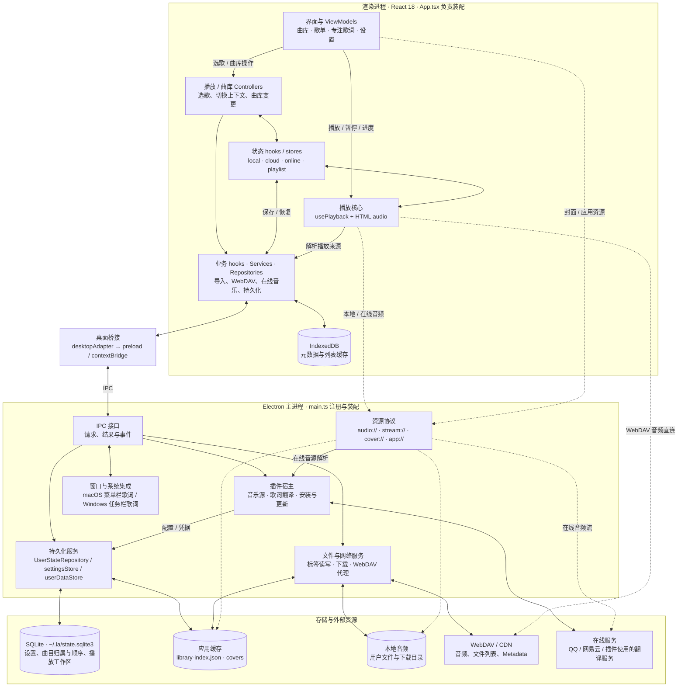

# LyricsAdapter 架构说明

本文按当前源码梳理 LyricsAdapter 的运行时边界、核心状态模型、数据持久化和主要业务流。架构图、持久化与插件边界于 2026-10-11 核对；后续扩展计划见开发文档。

## 总览

LyricsAdapter 是一个 Electron + React 18 + Vite 桌面音乐播放器。Electron 主进程负责窗口、文件系统、协议、IPC、SQLite 用户状态、WebDAV 代理、插件宿主和系统能力；renderer 进程负责 React UI、播放状态、曲库状态、导入流程、WebDAV 列表同步和在线音乐交互。

下图以桌面端为主。实线表示调用或状态关系，虚线表示媒体资源请求；连线展示主要职责边界，双向线包含返回值或事件。

阅读图时需要区分三组边界：

- `activeSlotId` 决定播放上下文，`viewSlot` 决定浏览的曲库；两者可以不同。
- SQLite 保存桌面端结构化用户状态，`library-index.json`、封面与 IndexedDB 保存可重建缓存。
- 音乐源与歌词翻译插件运行在主进程；浏览器模式没有该插件宿主，设置和曲库分别使用 localStorage、IndexedDB。

## 运行时分层

### Electron 主进程

入口是 `electron/main.ts`。启动时先注册自定义 scheme；在 `app.whenReady()` 中初始化 `UserStateRepository`，再注册协议与 IPC，最后创建窗口。SQLite 初始化或迁移失败会中止启动，避免使用空的或未完成迁移的用户状态。

主要职责：

| 模块 | 职责 |
| --- | --- |
| `electron/windowManager.ts` | 创建 frameless 窗口、管理生命周期和窗口状态 |
| `electron/protocols/audioProtocol.ts` | 注册 `audio://`，用 Range + `fs.createReadStream` 流式读取本地音频 |
| `electron/protocols/coverProtocol.ts` | 注册 `cover://`，从 `userData/covers` 读取封面并按 `?size=N` 降采样 |
| `electron/protocols/streamProtocol.ts` | 注册 `stream://`，调用已启用的音乐源插件解析 CDN URL、取得请求头并转发 Range 请求 |
| `electron/protocols/appProtocol.ts` | 注册应用资源协议 |
| `src/shared/ipcContract.ts`、`electron/ipc/ipcMainTyped.ts` | 全部 IPC 通道的唯一契约（通道名、参数、结果、事件）；主进程只通过 `handleIpc` / `onIpc` / `sendIpc` 注册和发送 |
| `electron/ipc/typedHandlers.ts` | typed IPC: 文件选择/读取、library index、WebDAV，带 payload 校验 |
| `electron/ipc/fileHandlers.ts`、`coverHandlers.ts`、`windowHandlers.ts` 等 | 文件校验、封面、窗口、下载等位置参数通道，按领域分别注册 |
| `electron/ipc/musicPluginHandlers.ts` | 音乐源与翻译调用、安装/启停/更新、凭据变更事件，以及 QQ/网易登录的兼容通道 |
| `electron/services/musicPluginRegistry.ts`、`pluginRuntime.ts` | 插件发现、合同校验、加载、激活与释放 |
| `electron/services/userStateRepository.ts` | SQLite 用户状态、事务、首次迁移与敏感值加密 |
| `electron/services/persistenceRepository.ts`、`persistenceCommitService.ts` | 聚合启动读取与关闭最终提交；区分用户状态和缓存结果 |
| `electron/ipc/metadataHandlers.ts`、`services/audioMetadataService.ts` | 通过 `music-tag-native` 读取、刷新和写入音频标签 |
| `electron/services/systemLyricsCoordinator.ts` | 协调 macOS 菜单栏歌词与 Windows 任务栏歌词的生命周期和操作回传 |

主进程也维护音频路径 allowlist。用户通过文件选择或拖拽授权后的音频路径才允许通过 IPC 读取；app-managed `userData/audio` 也被视为可读范围。

### Preload 桥

`electron/preload.ts` 通过 `contextBridge.exposeInMainWorld('electron', ...)` 暴露受控 API。它同时包含：

- typed IPC 命名空间（`ipc.*`）：文件、曲库、WebDAV、设置、用户状态、聚合持久化及原生窗口组件。
- 扁平 API：窗口控制、封面、下载、元数据读写、更新器等，每个能力只有一条通道。
- 插件能力：音乐源调用、翻译请求与取消、插件配置和安装更新管理。
- 事件订阅：下载进度、窗口关闭前 flush、快捷键、更新器及插件状态/凭据变更。

暴露对象的类型是 `src/shared/electronBridge.ts` 的 `ElectronBridge`，preload 以 `satisfies` 声明，`desktopAdapter` 也基于该类型实现；preload 的 `invoke` / `listen` / `send` 与主进程的注册都从 `ipcContract.ts` 取类型，任何一侧与契约不一致都无法通过编译。`test/electron/ipc/ipcContract.test.ts` 另外检查没有绕过类型化 helper 的原始调用，且每个契约通道都有主进程实现。

renderer 业务代码通过 `services/desktopAdapter.ts` 使用这些能力，避免直接读写 `window.electron`。在线音乐凭据由主进程 `settingsStore` 提供；`syncOnlineCookiesToMain()` 保留兼容通知，`stream://` 对应通道只清除已解析的 CDN URL 缓存，不再维护另一份 cookie store。

### Renderer 进程

renderer 的根组合点是 `App.tsx` 中的私有 `AppContent`。默认导出的 `App` 只负责用 `ErrorBoundary` 包住 `AppContent`；后者挂载全局 `<audio>`，组合 stores、controllers、viewmodels、业务 hooks 与 `AppShell`。

当前主要意图边界是：

- `usePlayerController` 负责跨 slot 选歌、搜索定位、在线流播放、歌单播放上下文和歌单歌词窗口。
- `useLibraryController` 负责 view-slot-aware 删除、批量删除、重排、元数据更新和下载完成后的曲库写入。
- player/library/import/online viewmodel 向 `AppShell` 提供面向 UI 的状态和回调。
- `AppContent` 保留应用级装配，例如持久化快照、启动恢复、cookie 启动同步、生命周期注册和孤儿缓存清理。

文件长度不作为组合根的架构边界；判断标准是领域状态变更是否继续由对应 controller、hook 或 service 持有。

## 插件架构

### 宿主与扩展点

插件由 `electron/ipc/musicPluginHandlers.ts` 在主进程注册。`MusicPluginRegistry` 从用户状态目录下的 `plugin/<plugin-id>/` 发现已安装插件，默认目录是 `~/.la/plugin`；校验清单和入口后按需加载。未安装插件也可以启动播放器。

当前公开合同定义在 [`src/shared/plugin.ts`](../../src/shared/plugin.ts)，核心 API 为 `1.0.0`：

| 扩展点 | 当前职责与边界 |
| --- | --- |
| `music.source@1.0.0` | 搜索、歌曲/歌单、歌词、播放 URL 与登录相关能力；界面目前接入 QQ 和网易云 |
| `lyrics.translation@1.0.0` | 接收歌词文档与目标语言，按行返回译文；在插件设置中选择后供专注模式使用 |

`PluginRuntime` 管理新 API 的激活、调用与释放，提供配置、私有存储、凭据、日志和网络等 SDK 服务；旧 `apiVersion: 1` 音乐插件仍通过兼容路径加载。自定义音乐源 ID 可以在宿主层注册和调用，但尚未完整接入搜索、播放槽和登录 UI；翻译插件支持自定义 ID。

### 调用与状态所有权

- 搜索、歌单、歌词和 URL 查询由 renderer 的 `createMusicPluginProvider()` 通过 `desktopAdapter.musicPluginCall()` 进入主进程 registry；平台协议实现在 Node 插件中。
- 在线播放由 `usePlayerController` 建立 `online` 或 `playlist` 上下文，`usePlayback` 构建 `stream://` URL；协议处理器再向插件解析音源，并使用插件提供的请求头代理 CDN 音频。
- 翻译走独立的 `plugin-translate` / `plugin-cancel` 通道，主进程跟踪请求并支持取消。
- 曲库变更和播放状态仍归应用的 controller、hook 与 service 所有。公开插件 API 尚未提供播放器控制、媒体库写入、任意 React 页面注入或桌面歌词扩展。

### 安装、更新与凭据

`MusicPluginCatalog` 与 `PluginUpdateService` 负责插件目录查询、下载、更新源和版本检查，registry 执行 `.laplugin` 包安装、启停、更新与卸载。插件状态和更新事件通过 IPC 通知 renderer；平台插件禁用、更新或卸载时会释放运行时资源。

插件启用状态、配置、私有存储和更新设置通过宿主写入 SQLite。凭据统一经 `settingsStore` 读取；QQ/网易沿用兼容键，新插件使用 `music-plugin:<id>:secret:<name>`。这些 secret 键与 WebDAV 配置、QQ credential 等均受敏感设置策略保护，持久化时使用 `safeStorage` 加密。

插件运行在主进程的 Node 环境，当前宿主没有进程隔离或不可信代码沙箱。SDK 网络和凭据权限约束适用于 SDK 调用，不能阻止可信 Node 插件直接使用 Node API。

清单、SDK、版本兼容与分发细节见[插件 API 文档](../plugins/README.md)。

## 核心状态模型

### Track

`types.ts` 中的 `Track` 是统一曲目模型。所有来源最终都归一为这个结构。

关键字段：

| 字段 | 含义 |
| --- | --- |
| `id` | 曲目身份。local 多由导入生成，WebDAV 为 `webdav-${webdavPath}`，在线为 `online-${source}-${songmid}` |
| `title/artist/album/duration` | 展示与播放所需元数据 |
| `coverUrl` | 封面 URL，可为 `cover://`、http(s)、data/blob 或占位图 |
| `lyrics/syncedLyrics` | 纯文本或同步歌词 |
| `audioUrl` | HTML audio 使用的 URL。持久化时会清空 |
| `filePath/fileName/fileSize/lastModified` | 本地或 WebDAV 身份、校验、排序信息 |
| `source` | `local`、`webdav`、`qq`、`netease` |
| `webdavPath` | WebDAV 远端路径 |
| `songmid` | 在线音乐曲目 id，供 `stream://` 重新构建 URL |
| `available` | 本地路径校验结果。文件不存在时可保留条目但标记不可用 |

### LibrarySlot

当前 `SlotId` 是四种：

| Slot | 用途 | 是否可作为播放上下文 | 是否普通库视图 |
| --- | --- | --- | --- |
| `local` | 本地导入曲库 | 是 | 是 |
| `cloud` | WebDAV 云曲库 | 是 | 是 |
| `online` | 在线搜索结果的最近播放队列，LRU | 是 | 是 |
| `playlist` | 第三方歌单播放上下文 | 是 | 否。没有侧边栏入口，常用于 Playlists 视图背后的播放队列 |

每个 `LibrarySlot` 保存：

- `tracks`
- `currentTrackIndex`
- `currentTime`
- `volume`
- `playbackMode`
- `scrollPosition`
- `filterType`
- `categorySelection`

这让每个 slot 可以恢复自己的播放位置、音量、播放模式和列表浏览状态。

### activeSlotId 与 viewSlot

源码里有两个容易混淆但很重要的概念：

| 概念 | 所属 | 含义 |
| --- | --- | --- |
| `activeSlotId` | `stores/libraryState.ts`（由 `useLibrarySlots` 写入） | 当前真正的播放上下文，`usePlayback` 使用 `slots[activeSlotId]` |
| `viewSlot` | `stores/libraryState.ts`（由 `useLibraryStore` 写入） | 当前曲库面板正在浏览的 slot |

这两个值可以不同。例如用户正在播放 `playlist` slot 中的在线歌单，同时曲库面板仍显示 `local` 或 Playlists 视图。删除、重排、导入这类库操作应面向 `viewSlot`，播放控制应面向 `activeSlotId`。

### 状态存储与组合 hook

`src/stores/` 只放外部状态容器（`createStore` + `useSyncExternalStore`），不依赖 hooks、controllers 或组件（依赖检查规则 `stores-hold-state-only`）。

| 文件 | 作用 |
| --- | --- |
| `stores/libraryState.ts` | 曲库领域状态：四个 slot、`activeSlotId`、`viewSlot`。实例由 `AppContent` 创建并经 `LibraryStateProvider` 提供；组件用 `useLibraryState(selector)` 读取所需切片，写入只经 `useLibrarySlots` 与 controllers。更新立即生效，`getSlots()` 能读到尚未渲染的最新值 |
| `stores/musicPluginStore.ts`、`stores/pluginTranslationStore.ts` | 插件列表与歌词翻译偏好的订阅 |

组合 hook 位于 `src/hooks/`：

| 文件 | 作用 |
| --- | --- |
| `hooks/useLibraryStore.ts` | 包装 `useLibrarySlots`，增加 slot 切换动画、云端可写性检测、滚动位置和分类选择 |
| `hooks/usePlayerStore.ts` | 包装 `usePlayback` 与 `useBlobUrls`。音量和播放模式是全局状态，不再镜像进 slot；持久化快照把实时值写到 active slot |
| `hooks/useImportStore.ts` | 包装 `useImport`，根据 `viewSlot` 路由本地导入或 cloud 上传 |
| `hooks/useUIStore.ts` | 聚合视图模式、焦点模式、页面动画、未保存元数据导航拦截、窗口焦点和玻璃 UI 状态 |

## 数据持久化

### SQLite 用户状态与缓存边界

桌面端结构化用户状态的权威是 `~/.la/state.sqlite3`，由主进程 `UserStateRepository` 通过 `node:sqlite` 管理。`settingsStore`、`userDataStore` 与 IPC 保留上层接口，renderer 不直接访问数据库。

| 数据 | 保存位置 | 角色 |
| --- | --- | --- |
| 设置、偏好与插件配置/凭据 | SQLite `settings` | 用户状态；敏感值加密后落盘 |
| 四个 slot 的曲目归属与顺序 | SQLite `tracks` | 用户状态；保存曲目引用与最小记录 |
| 初始化标记与播放工作区 | SQLite `workspace_state` | 区分未初始化和显式空库，保存各 slot 恢复状态 |
| 数据库迁移记录 | SQLite `schema_migrations` | 数据版本校验 |
| 曲库展示快照 | `userData/library-index.json` | 可重建的快速恢复缓存 |
| 封面、元数据、文件列表、歌单和 CDN URL | `userData/covers/`、IndexedDB | 可重建缓存，CDN URL 有有效期 |
| 原始与下载音频 | 用户选择的路径、下载目录 | 音频内容，不属于可清理缓存 |

`libraryInitialized: true` 且 tracks 为空表示用户的合法空库，旧缓存不能恢复已删除的曲目。旧 `settings.json`、`users.json` 及其备份仅参与首次创建 SQLite 的迁移；迁移后冻结，不再参与正常读写或双写。

### Library index 展示缓存

renderer 的 `services/libraryStorage.ts` 经 `desktopAdapter` 调用主进程，读写 `app.getPath('userData')/library-index.json`。缓存由 `services/librarySerializer.ts` 构建：

- `songs`: local tracks
- `cloudSongs`: cloud tracks
- `onlineSongs`: online LRU tracks
- `playlistSongs`: playlist play context
- `settings`: 每个 slot 的非 track 状态、`activeSlotId`、Playlists 视图状态等

序列化时会清空 `audioUrl`，并通过 `sanitizePersistedCoverUrl` 去掉 `blob:`、`file:`、`data:` 这类不可跨会话稳定使用的封面 URL。缓存中的标题、歌词、封面等用于补齐展示；曲目归属、顺序和恢复工作区以 SQLite 用户状态为准。

### Library load/save 生命周期

`hooks/useLibraryLoad.ts` 通过 renderer Repository 协调以下流程：

1. 启动经 `libraryPersistenceRepository.loadBootstrap()` 聚合读取设置、用户状态和展示缓存；以 SQLite 的归属和顺序重建四个 slot，并用缓存补齐展示字段。
2. 恢复 index、进度、音量、模式和浏览状态，保持 `isPlaying = false`；初始化元数据缓存并在后台校验本地文件路径。
3. 运行期把曲目归属和对应 playback 快照放进同一写队列，经 `userDataSaveLibraryState` 在一个 SQLite 事务中提交；独立防抖更新展示缓存。
4. 高频播放进度从实时播放时钟读取，以 5 秒 leading + trailing 节流加入同一串行队列，避免较旧的曲库快照覆盖较新的进度。
5. 关闭时先排空运行期写入，再从同一份四槽状态捕获最终快照，由 `libraryClosePersistenceRepository` 调用主进程 `PersistenceCommitService`：先尝试 SQLite 事务，最后单独写展示缓存，分别返回结果。

普通设置在变更时通过 `AppStorage` 独立写入，不随曲库或关闭快照全量替换。缓存写入失败不会回滚已提交的 SQLite 用户状态；关闭提交包含失败时，不会被报告为完整持久化成功。

### 设置与浏览器模式

桌面端 `AppStorage` 只在 renderer 内存中保存同步读取快照，持久化后端是主进程 SQLite，不将设置镜像到 localStorage。`webdav-config`、QQ/网易凭据及插件 secret 键由统一策略识别并经 `safeStorage` 加密。仓库层拒绝无法加密的敏感值落盘；`settingsStore` 可将写入失败的 secret 保留于当前进程内存，不会降级为明文持久化。

浏览器模式没有 SQLite、Electron IPC 或插件宿主：`AppStorage` 使用 localStorage，曲库和元数据使用 IndexedDB。因此，桌面端“IndexedDB 可重建”的规则不能直接套用到浏览器曲库。

事务、迁移、凭据和失败恢复细节见[持久化现状与 SQLite 边界](./persistence-current-state.md)。

### IndexedDB

`services/indexedDBStorage.ts` 保存 renderer 侧缓存：

- 普通 metadata cache。
- WebDAV metadata cache。
- WebDAV file list snapshot，用于 PROPFIND 后做 diff。
- 在线歌单列表与 WebDAV CDN URL 等可替换缓存。
- browser-mode library；这部分在浏览器模式下是曲库存储。

桌面端 cookie、用户设置、侧栏布局和歌单覆盖由 `AppStorage` / SQLite 保存；IndexedDB 中历史设置仅在需要时作为一次性迁移来源。

`services/metadataCacheService.ts` 在内存 Map 和 IndexedDB 之间提供 LRU/FIFO 风格缓存，最大 300 条，写入时做数据校验。

### 封面缓存

内嵌封面会尽量通过主进程保存到 `userData/covers/`，再以 `cover://<safe-id>.<ext>` 暴露。`coverProtocol` 支持 `?size=N` 缩略图降采样，`TrackCover` 会对 `cover://` 追加缩略图参数并在失败时重试。

WebDAV 封面使用 `webdavCoverId(webdavPath)` 构造稳定 id，避免不同远端路径经清洗后发生文件名碰撞。

## 导入与曲库变更

### 本地导入

本地导入入口在 `useImport`，通过 `useImportStore` 由 `viewSlot` 路由。

桌面模式流程：

1. `desktopAdapter.selectFiles()` 打开系统文件选择。
2. 过滤支持格式和重复文件。
3. 分批调用 `desktopAdapter.parseAudioMetadata(filePath)`。
4. `ElectronAdapter.parseAudioMetadata()` 优先经 IPC 调用主进程 `audioMetadataService` / `music-tag-native`；失败或旧桥缺少该接口时，才读取文件并回退到 renderer parser。
5. 封面优先保存为 `cover://`。
6. 生成 `Track`，更新 local tracks。
7. 更新元数据与展示缓存，由持久化流程保存 SQLite 曲目归属和 playback。

拖拽路径导入使用 `getPathForFile` 获取真实路径，并通过 typed IPC 把路径加入 allowlist。

浏览器模式使用 `File` 对象，直接创建 blob URL 和 IndexedDB library。

### WebDAV cloud 导入

当 `viewSlot === 'cloud'` 时，导入按钮和拖拽路径会走 cloud 上传：

1. 检查 WebDAV 配置与可写性。
2. 读取本地文件字节。
3. 解析本地元数据和封面。
4. `webdavClient.uploadFile()` PUT 到 WebDAV 根目录。
5. 构造 `source: 'webdav'` 的 Track。
6. `mergeCloudTracks()` 合并进 cloud slot，按 `lastModified` 排序并处理同名去重。

### 在线音乐下载/上传

在线 provider 抽象在 `services/onlineMusicProvider.ts`，QQ 和网易都归一成 `OnlineSong`。`services/musicPluginProvider.ts` 提供 renderer façade，搜索、歌词、歌单与 URL 查询最终由主进程中已启用的音乐源插件执行。

`useOnlineMusicIntegration` 负责：

- 下载到用户设置的下载目录。
- 拉歌词和封面。
- 调主进程 `downloadAndSave` 保存音频。
- 调 `writeAudioMetadata` 写标签。
- 上传到 WebDAV 时再读本地文件字节，PUT 到远端，并上传 `.meta.json`，随后把 Track 合并进 cloud slot。

在线音乐 provider 只负责搜索、获取 URL、歌词、歌单等，不直接控制播放器。播放意图由 `usePlayerController` 处理，`AppContent` 只负责装配 controller 与 viewmodel。

## 播放架构

播放由 `usePlayerStore` 包装 `usePlayback` 提供。

核心职责：

- 绑定全局 `<audio>`。
- 根据当前 `Track.source` 选择播放 URL。
- 控制播放/暂停、seek、音量、上下曲、播放模式。
- 在 `timeupdate` 后更新播放状态与实时播放时钟；持久化快照读取该时钟，跨 slot 切换时保存旧上下文进度。
- 在音量/播放模式变化后同步回 active slot。
- 在 `loadedmetadata` 后恢复进度和更新本地曲目时长。
- 处理 WebDAV CDN URL 失效恢复、blob URL 清理和 canplay 重试。

播放 URL 的来源：

| 来源 | URL | 生成位置 | 实际服务方 |
| --- | --- | --- | --- |
| 本地桌面文件 | `audio://localhost/<absolute-path>` | `usePlayback.loadAudioFileForTrack` | `audioProtocol` 流式读磁盘 |
| 浏览器 File/blob | `blob:` | `metadataService.parseAudioFile` | 浏览器内存对象 URL |
| WebDAV | CDN/http(s) URL | `webdavClient.getCdnUrl()` | WebDAV GET redirect 后的远端 CDN |
| QQ/网易在线播放 | `stream://<source>/<songmid>?q=320` | `usePlayback` | `streamProtocol` 调用音乐源插件解析 CDN 并转发 |

更详细的链路见 [播放流程说明](./playback-flow.md)。

## WebDAV 云曲库

WebDAV 客户端在 `services/webdavClient.ts`，配置通过 `AppStorage` 的 `webdav-config` 读写：桌面端加密保存于 SQLite，浏览器模式使用 localStorage。短期 CDN URL 缓存独立放在 IndexedDB。它负责：

- PROPFIND 列目录。
- 解析 WebDAV href 为稳定路径。
- 获取 CDN redirect URL。
- Range 读取文件头或封面区间。
- PUT/DELETE/MKCOL。
- 可写性探针。
- 本地 CDN URL cache。

`hooks/useLibraryCloudSync.ts` 在 `LibraryView` 中使用 `useWebDAV`：

- 首次进入 cloud slot 自动加载。
- 手动 refresh 重新扫描。
- 把 full 或 diff 结果回传到上层 `loadCloudTracks` / `mergeCloudTracks`。
- 注册 debug commands: `clear_webdav_cache`、`sync_webdav`、`scan_webdav_audio`、`webdav_meta_update`。

`hooks/useWebDAV.ts` 的加载策略：

1. PROPFIND 得到音频文件列表。
2. 与 IndexedDB 中的 file list snapshot 做 diff。
3. 无变化且 metadata cache 完整时，直接从 IndexedDB 重建 tracks。
4. 有新增/变更时，只解析新增/变更文件。
5. 首次或缓存不完整时进入 full mode。
6. 可写且 provider 支持时，把 metadata 写回 WebDAV `/Metadata/`。

hook 只负责 React 状态和上述加载顺序，具体实现位于 `services/webdav/`：

| 文件 | 作用 |
| --- | --- |
| `trackMapping.ts` | 纯函数：列表 diff、占位曲目、元数据合并、listing 快照 |
| `metadataReader.ts` | 按 provider 策略读取 meta.json 或文件头（带重试），解析标签、歌词和封面 |
| `coverStore.ts` | 封面在 blob: / data: / 本地 cover:// 之间转换与保存 |
| `metadataCache.ts` | IndexedDB 中的逐文件元数据缓存 |
| `manifestSync.ts` | 串行合并并上传 `/Metadata/` manifest 与 chunks |
| `chunkDetails.ts` | 后台从 chunks 补全封面和歌词，并回写 manifest 修正 |

WebDAV `/Metadata/` 当前是 v3 manifest + chunks：

- `_manifest.json` 保存轻量字段、文件指纹、chunkId 和是否有封面/歌词。
- `_chunk_0001.json` 等保存重量字段：封面 data URL、歌词、同步歌词。
- 写入顺序是 chunk-first、manifest-last，避免 manifest 指向未写好的 chunk。

Provider 策略在 `services/webdav/providerConfig.ts`，目前包含 generic 和 123pan 特化。用户设置 readonly 时会强制关闭写入和自动上传元数据。

## 元数据

桌面端默认通过 `electron/ipc/metadataHandlers.ts` 调用 `electron/services/audioMetadataService.ts`，由 `music-tag-native` 读取本地文件标签。浏览器模式、桌面兼容回退和 WebDAV 部分读取仍使用 renderer 解析路径：

- `metadataService.parseAudioFile(file)` 优先使用 `services/workers/metadataWorker.ts`，失败时回到主线程 parser。
- 支持 MP3 ID3v2、FLAC metadata block/VORBIS_COMMENT/PICTURE、M4A/MP4 atoms。
- LRC 通过 `parseLRCLyrics()` 转为 `syncedLyrics`。
- WebDAV Range 解析使用 `parseMetadataFromBuffer()`，当文件头不足以包含封面或完整 Vorbis comment 时返回需要补读的 range。

主进程写入：

- `electron/services/audioMetadataService.ts` 的 `writeAudioMetadata()` 通过 `music-tag-native` 保存通用标签。
- `wordLyricsTagService` 在通用标签保存后处理 QRC/YRC 自定义标签，其中 MP3 逐字标签通过 `node-id3` 读写。
- coverUrl 可来自 data URL、`cover://` 或远程 http(s)。

## 当前边界与注意事项

当前架构已经有清晰的跨进程边界和 slot 模型，但还有一些需要重构时特别留意的点：

- `AppContent` 仍直接编排持久化快照和孤儿缓存清理；若继续增长，应按领域边界下沉，而不是按行数机械拆文件。
- `useLibraryActions` 目前仍保留文件重载入口，曲库 mutation 则由 `useLibraryController` 统一持有。
- `useImport` 同时处理文件选择、批处理、元数据解析、通知、持久化和 WebDAV 上传。
- `useLibraryCloudSync` 由 `AppShell` 触发云同步，UI 组件仍承载这一业务副作用入口。
- `desktopAdapter` 已提供业务侧统一入口；`index.tsx` 的启动平台探测是剩余的边界级直接读取。
- renderer 主线程 parser 与 worker parser 有重复实现，需要重构时保证解析行为一致。
